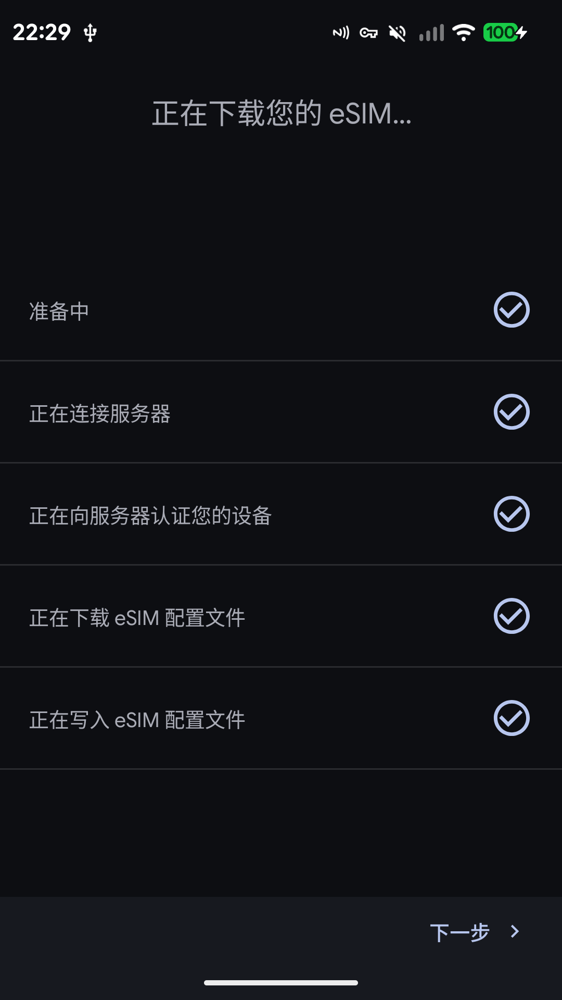
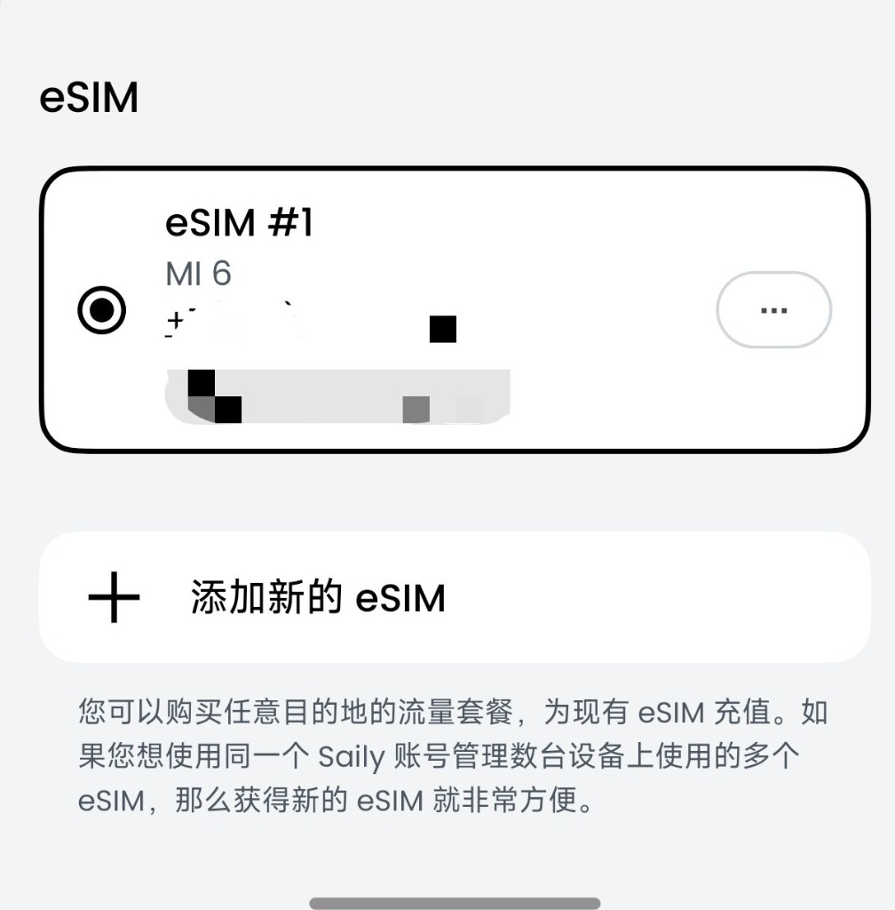

# Qualcomm Legacy eUICC Fix

面向老一代高通骁龙平台（如骁龙 835 / MSM8998、660 等）的通用、纯文本可审计 Root 模块（兼容 **Magisk / KernelSU / APatch**），用于让 `EasyEUICC` / `OpenEUICC` 在这些老机型上直接读写标准 GSMA eSIM 实体白卡（“小白卡”）。

> English summary is available at the bottom of this page.

---

## 问题原因（为什么老高通写不了标准小白卡？）

在以 **小米 6（`sagit` / 骁龙 835）** 为代表的老一代高通基带设备上：
- 基带 / `QMI_UIM` 固件对所有以 **GSMA 标准 7 字节前缀 `A0000005591010`** 开头的逻辑通道请求（`QMI_UIM_OPEN_LOGICAL_CHANNEL_REQ`）与 APDU 选择指令（`SELECT`）做了拦截，直接返回 **`QMI_ERR_ACCESS_DENIED (0x52)`**（系统表现为 `OPERATION_NOT_ALLOWED`）。
- 许多老机型或第三方 ROM 还缺少 `android.hardware.se.omapi.uicc` 权限声明，导致 App 无法通过 OMAPI 访问 SIM 卡槽。

结果就是：哪怕卡片本身自带 ARA-M 全放行规则，STK 菜单也能切卡，**`EasyEUICC` 依然报错读不出 EID，更无法写入新 eSIM**。

## 绕过原理（ISO 7816-4 部分 AID 匹配）

标准 GSMA ISD-R AID 为 16 字节：`A0000005591010FFFFFFFF8900000100`。

利用 **ISO 7816-4 部分 AID 匹配（Partial AID Selection）** 机制，将打开通道与 `SELECT` 的 AID 缩短为 **6 字节前缀 `A00000055910`**：
1. 成功避开高通基带对 7 字节前缀 `A0000005591010` 的拦截规则（`0x52`）。
2. 智能卡收到 `A00000055910` 后按协议前缀匹配到首位的标准 ISD-R 应用（`A0000005591010FFFFFFFF8900000100`），后续所有 ES10x 读卡、下载/写入、启用/切换、删除操作全部恢复正常。

实测已在小米 6（`MSM8998`，基带 `AT20-0506_2249_2f010e6`，Android 17 GSI + KernelSU）上跑通完整 OMAPI 读卡与 eSIM 下载、写入、删除全流程。

### 实测截图（小米 6 / Saily eSIM 写入实测）

| EasyEUICC 完整下载并写入 eSIM 配置文件 | Saily 端识别设备为 `MI 6` |
| :---: | :---: |
|  |  |

---

## 兼容性说明与边界

| 项目 | 说明 |
| --- | --- |
| **Root 管理器** | Magisk v20.4+、KernelSU / KernelSU Next、APatch |
| **Android ROM** | 不限 ROM（MIUI / HyperOS 移植 / LineageOS / AOSP GSI，Android 9 ~ 17 均可） |
| **已验证目标 App** | **`EasyEUICC` / `OpenEUICC` `v1.7.2`**（基于 Jetpack DataStore `prefs.preferences_pb` 的 Base64 `isdr_aid_list` 格式） |
| **实体卡要求** | 1. 支持 ISO 7816-4 部分 AID 匹配且 ISD-R 位于匹配首位；<br>2. 免 Root 方案（EasyEUICC）需卡片自带对应的 ARA-M 放行规则（常见无限制白卡均自带）。 |

> [!NOTE]
> **版本变动兜底与免 Root 提示**：
> - 如果你的手机当前 ROM **原厂已经自带** `android.hardware.se.omapi.uicc` 特性，甚至**不需要 Root 也不需要本模块**——直接按下方“手动配置”即可。
> - 如果未来 `EasyEUICC` 升级变更了 DataStore 存储结构导致自动注入失效，也只需使用下方的手动配置方法即可继续生效。

---

## 使用方法

### 方式一：刷入模块（推荐，全自动）

1. 下载 Release 中的 `qcom-legacy-euicc-fix-v1.0.0.zip`（或按下方“安全审计与自行构建”自己打包）。
2. 在 Magisk / KernelSU / APatch 中刷入模块并**重启手机**。
3. 打开 **EasyEUICC** 即可直接读取卡片并写入/管理 eSIM。
   - **如果先刷模块、后安装 EasyEUICC**：装好 App 后，在管理器里点击本模块的 **“执行 / Action”** 按钮（或再重启一次）即可自动写入配置，无需手动填表。

### 方式二：手动配置（免 Root / 兜底方案）

1. 打开 `EasyEUICC` → 右上角 **设置** → 开启 **开发者选项**（若未开启，连续点击版本号或关于页启用，部分版本直接在设置底部可见）。
2. 进入 **ISD-R AID 列表（ISD-R AID list）**。
3. 在**第一行**填入：
   ```text
   A00000055910
   ```
   保留其余原有条目并保存，重新打开 EasyEUICC 即可。

---

## 模块内容与安全审计

本模块 **100% 纯文本（XML + POSIX Shell）**，**零二进制、零闭源 APK / SO**：

- `system/etc/permissions/android.hardware.se.omapi.uicc.xml`：Systemless 声明系统 OMAPI UICC 支持。
- `common/patch_euicc_prefs.sh`：`customize.sh`（安装时）、`service.sh`（开机后）、`action.sh`（手动点击执行时）共用的纯 Shell 注入脚本：
  - 检测到 `prefs.preferences_pb` 已含 `A00000055910`（Base64：`QTAwMDAwMDU1OTEw`）时直接跳过，完全幂等。
  - 修改前自动将原配置备份到模块目录 `backups/`（不污染 App 自己的 `datastore/` 目录），卸载模块时 `uninstall.sh` 会自动恢复。
  - 仅追加标准 Protobuf `MapEntry`（`isdr_aid_list`），保留用户已有设置，并自动匹配 `uid:gid` 与 SELinux 上下文。

### 本地校验与自行打包

仓库自带零第三方依赖的 Python 审计脚本，可逐字节反解校验注入的 Protobuf 载荷并打包：

```bash
# 1. 审计并校验脚本内的 Protobuf Base64 载荷与换行符
python tools/verify_payload.py

# 2. 重新构建可刷入模块 ZIP 并校验归档内容
python tools/build_zip.py
python tools/verify_payload.py --check-zip dist/qcom-legacy-euicc-fix-v1.0.0.zip
```

---

## English Summary

**Qualcomm Legacy eUICC Fix** is a 100% pure-text, auditable Magisk / KernelSU / APatch module that enables removable GSMA eUICC ("eSIM adapter card") provisioning on legacy Qualcomm devices (e.g., Snapdragon 835 / MSM8998 such as Xiaomi Mi 6).

### Root Cause & Fix
- Legacy Qualcomm `QMI_UIM` baseband firmware blocks `openLogicalChannel` / `SELECT` requests for any AID starting with the 7-byte GSMA prefix `A0000005591010` with `QMI_ERR_ACCESS_DENIED (0x52)`, and many ROMs omit `android.hardware.se.omapi.uicc`.
- Using **ISO 7816-4 Partial AID Selection** with the **6-byte prefix `A00000055910`** bypasses the modem filter and selects the card's standard ISD-R (`A0000005591010FFFFFFFF8900000100`).
- The module mounts `android.hardware.se.omapi.uicc.xml` systemlessly and safely appends `isdr_aid_list` (with `A00000055910` first) to `im.angry.easyeuicc` / `im.angry.openeuicc` (verified on **v1.7.2** Jetpack DataStore format).
- If your ROM already provides `android.hardware.se.omapi.uicc`, no Root or module is required — simply put `A00000055910` at the top of EasyEUICC's **Developer Options → ISD-R AID list**.

## License

[MIT](LICENSE)
